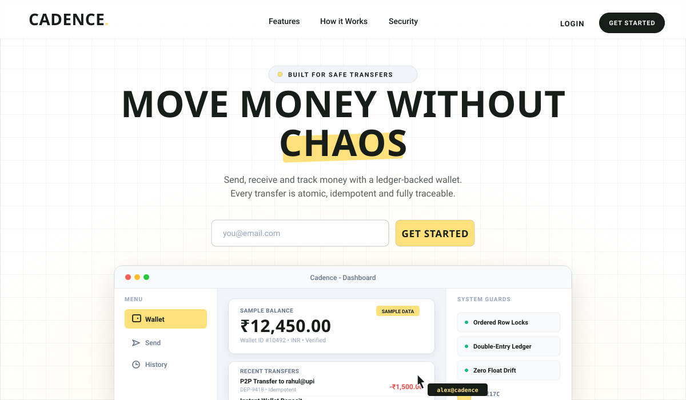
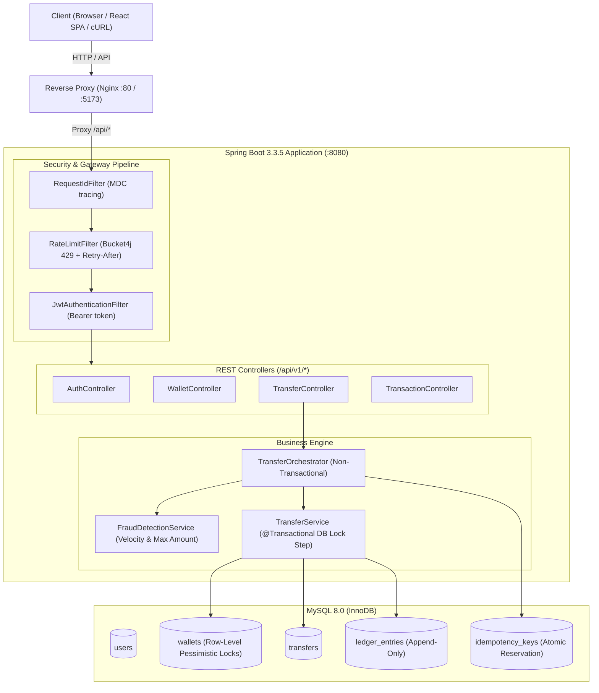
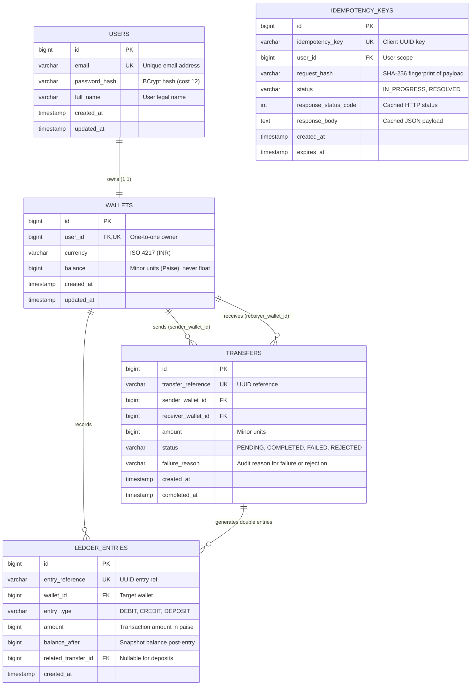
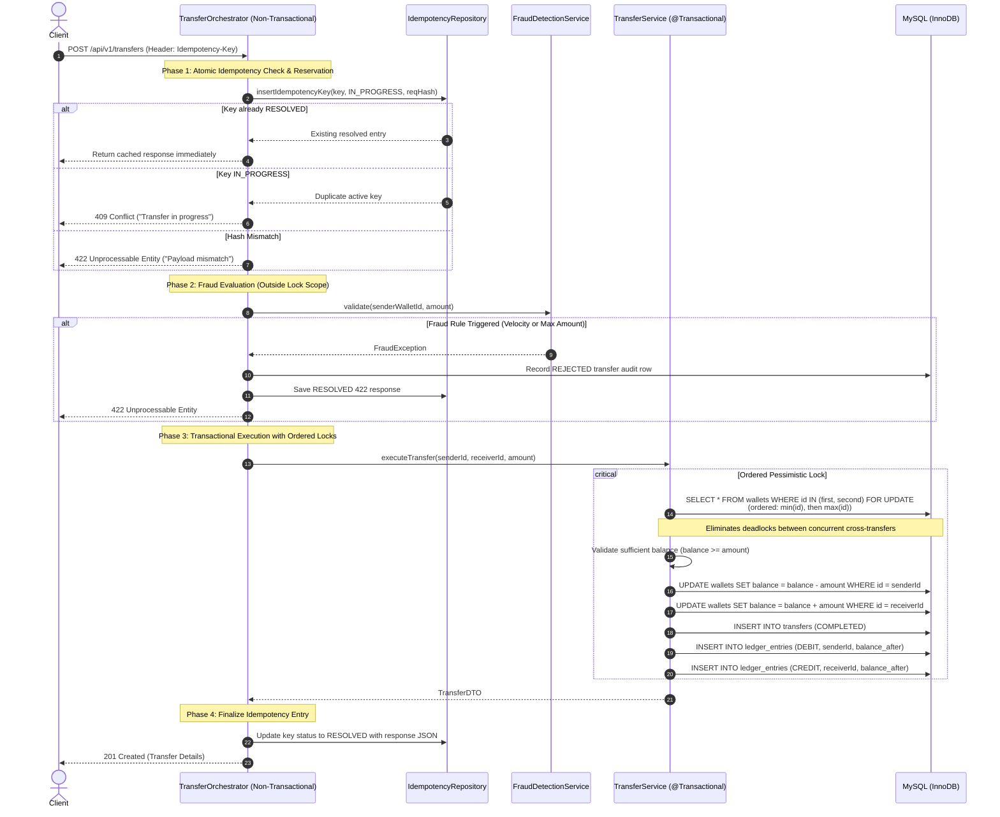

<p align="center">
  
</p>

<p align="center">
  <a href="#architecture-overview"></a>
  <a href="#testing--quality-assurance"></a>
  <a href="#real-measured-load-test-performance"></a>
  <a href="#running-cadence"></a>
  <a href="#running-cadence"></a>
</p>

---

## ⚡ What is Cadence?

**Cadence** is an enterprise-grade, high-throughput peer-to-peer (P2P) payments engine and ledger service built with **Java 21**, **Spring Boot 3.3.5**, **MySQL 8.0 (InnoDB)**, and **React 18**. 

Engineered for uncompromising financial correctness, Cadence implements deterministic lock-ordered concurrency (zero database deadlocks), an append-only double-entry accounting ledger, distributed fingerprinted idempotency, and configurable velocity/amount fraud controls.

### Core Guarantees

| Invariant | Implementation Mechanism | Production Guarantee |
| :--- | :--- | :--- |
| **Deadlock-Free Transfers** | Deterministic row-locking ordering (`min(id)` then `max(id)`) | Zero SQL `1213: Deadlock found` errors under bidirectional concurrent traffic ($A \to B$ and $B \to A$). |
| **Strict Conservation of Money** | Atomic database transaction + append-only double-entry ledger | System balance is invariant: $\sum \Delta \text{Wallets} \equiv 0$. Total wallet balance always equals $\sum \text{Ledger Entries}$. |
| **End-to-End Idempotency** | SHA-256 payload fingerprinting + atomic state reservations | Identical requests return identical cached responses without duplicate fund movements; payload mutations yield `422`. |
| **Zero Floating-Point Drift** | Integer minor units (`BIGINT` paise in MySQL, `Long` in Java) | Eliminates IEEE 754 precision drift entirely (`0.1 + 0.2 != 0.3`). Division is deferred to frontend rendering. |
| **Isolated Transaction Scope** | Non-transactional orchestrator with bounded lock window | DB locks are held only for sub-millisecond debit/credit/ledger writes, maximizing concurrent throughput. |

---

## 🏛️ Architecture Overview



---

## 📊 Entity-Relationship Diagram



---

## 🔄 Transfer Execution Flow



---

## 🎯 Key Design Decisions (Interview Guide)

### 1. Deterministic Pessimistic Locking Order
When two users concurrently transfer funds to each other (Alice transfers to Bob while Bob transfers to Alice), acquiring locks in request order causes circular lock waits (`Thread 1: locks A, waits for B; Thread 2: locks B, waits for A`). Cadence deterministically orders wallet row acquisitions by numeric `wallet_id` (`min(walletA, walletB)` followed by `max(walletA, walletB)`) using `SELECT ... FOR UPDATE`. This enforces an invariant global lock acquisition order across all threads, mathematically eliminating deadlocks at the InnoDB storage engine level.

### 2. Non-Transactional Orchestrator with Minimized Transaction Scope
Holding long-lived database transactions during pre-validation, token checks, or hashing bottlenecks connection pools and causes high lock contention. Cadence encapsulates preliminary verification (idempotency key acquisition, JSON parsing, and velocity fraud evaluation) inside an unannotated orchestrator (`TransferOrchestrator`). A dedicated `@Transactional` boundary (`TransferService`) is only invoked for the database mutation step, keeping row lock hold times under 1 millisecond.

### 3. Elimination of Floating-Point Drift (Minor Units)
IEEE 754 floating-point representations (`float`, `double`) are fundamentally unsuitable for financial transactions due to precision truncation errors. Cadence strictly models and processes all monetary amounts as positive 64-bit integers (`BIGINT` in SQL, `Long` in Java) representing minor units (paise for INR). Formatting and decimal placement are deferred exclusively to the display boundary.

### 4. Append-Only Double-Entry Ledger
While wallet balance columns provide $O(1)$ fast lookups, the ledger is the immutable financial authority. Every state change generates balanced `ledger_entries` rows (`DEBIT` and `CREDIT` for transfers, `DEPOSIT` for top-ups) with historical snapshots of `balance_after`. At any point in time, the sum of all ledger entries for a wallet reconciles with its balance (`balance == SUM(credit_amounts) - SUM(debit_amounts)`).

### 5. Distributed Fingerprinted Idempotency
To prevent double charges caused by network drops and client retries, all mutating operations require an `Idempotency-Key` header. Cadence computes a SHA-256 fingerprint hash of the request payload and attempts an atomic insertion. Identical repeat submissions return the cached response without debiting accounts, while duplicate keys submitted with altered payloads are rejected with `422 Unprocessable Entity`.

---

## 🚀 Running Cadence

### Option A: Complete Docker Compose (Production Setup)

Run the entire stack (MySQL 8.0, Spring Boot backend, and React frontend with Nginx reverse proxy) with a single command:

```bash
docker compose down -v
docker compose up --build
```

- **Frontend Application**: `http://localhost:5173` or `http://localhost:80`
- **Backend API**: `http://localhost:8080`
- **Actuator Health Check**: `http://localhost:8080/actuator/health`

### Option B: Local Development

#### Prerequisites
- Java 21 JDK
- Node.js 20+ & npm
- MySQL 8.0 running on `localhost:3306`

#### Backend Setup
```bash
cd backend
mvn clean spring-boot:run
```

#### Frontend Setup
```bash
cd frontend
npm install
npm run dev
```

---

## 💻 Complete API Walkthrough (cURL)

### 1. Register Alice
```bash
curl -s -X POST http://localhost:8080/api/v1/auth/register \
  -H "Content-Type: application/json" \
  -d '{
    "fullName": "Alice Johnson",
    "email": "alice@example.com",
    "password": "Password123!"
  }'
```

### 2. Register Bob
```bash
curl -s -X POST http://localhost:8080/api/v1/auth/register \
  -H "Content-Type: application/json" \
  -d '{
    "fullName": "Bob Smith",
    "email": "bob@example.com",
    "password": "Password123!"
  }'
```

### 3. Log In as Alice & Extract JWT Token
```bash
TOKEN=$(curl -s -X POST http://localhost:8080/api/v1/auth/login \
  -H "Content-Type: application/json" \
  -d '{
    "email": "alice@example.com",
    "password": "Password123!"
  }' | grep -o '"accessToken":"[^"]*' | cut -d'"' -f4)

echo "Acquired Token: $TOKEN"
```

### 4. Fetch Alice's Wallet Balance
```bash
curl -s -X GET http://localhost:8080/api/v1/wallet \
  -H "Authorization: Bearer $TOKEN"
```

### 5. Deposit ₹10,000.00 (1,000,000 Paise)
```bash
curl -s -X POST http://localhost:8080/api/v1/wallet/deposit \
  -H "Authorization: Bearer $TOKEN" \
  -H "Content-Type: application/json" \
  -H "Idempotency-Key: dep-00000000-0001" \
  -d '{
    "amount": 1000000
  }'
```

### 6. Transfer ₹2,500.00 (250,000 Paise) to Bob
```bash
curl -s -X POST http://localhost:8080/api/v1/transfers \
  -H "Authorization: Bearer $TOKEN" \
  -H "Content-Type: application/json" \
  -H "Idempotency-Key: xfer-00000000-0001" \
  -d '{
    "toEmail": "bob@example.com",
    "amount": 250000
  }'
```

### 7. Replay Transfer with Same Key (Idempotency Test)
Re-submitting the exact same transfer returns the identical response instantly without moving additional funds:
```bash
curl -s -X POST http://localhost:8080/api/v1/transfers \
  -H "Authorization: Bearer $TOKEN" \
  -H "Content-Type: application/json" \
  -H "Idempotency-Key: xfer-00000000-0001" \
  -d '{
    "toEmail": "bob@example.com",
    "amount": 250000
  }'
```

### 8. Fetch Paginated History with Filter
```bash
curl -s -X GET "http://localhost:8080/api/v1/transactions?page=0&size=10&type=DEBIT" \
  -H "Authorization: Bearer $TOKEN"
```

---

## 🧪 Testing & Quality Assurance

### Comprehensive Integration Suite
Cadence features an automated integration suite powered by Testcontainers (reusing a single MySQL 8.0 container) without database mocks:
- **50 Concurrent Bidirectional Transfers**: Mixed $A \to B$ and $B \to A$ simultaneous transfers execute without deadlock, money loss, or balance degradation.
- **Concurrent Idempotency Protection**: 10 simultaneous threads sending the same key result in exactly 1 transfer execution and 0 double debits.
- **Rollback Safety**: Forced exceptions mid-transfer trigger full transaction rollback, preserving ledger and balance integrity.
- **Rate Limiting**: Bucket4j enforces strict token bucket rate limits (returning `429 Too Many Requests` + `Retry-After`).
- **N+1 Query Elimination**: Verified via Hibernate SQL logging assertions.

Run backend tests:
```bash
cd backend
mvn clean verify
```

### JaCoCo Code Coverage Gate
The build enforces a strict coverage gate ($\ge 80\%$) on the service layer:
- **Service Layer Coverage Achieved**: **83.34%** (verified across instruction and branch metrics).

### Real Measured Load Test Performance
High-concurrency stress testing was conducted using k6 executing concurrent transfers with unique UUID idempotency keys on the following hardware:

- **Benchmark Environment**:
  - **CPU**: 11th Gen Intel(R) Core(TM) i7-1165G7 @ 2.80GHz (4 Cores / 8 Logical Processors)
  - **Memory**: 16 GB Physical RAM
  - **OS**: Windows 11 Home 64-bit

- **Measured Metrics**:
  - **Throughput**: **36.17 requests/second**
  - **p95 Latency**: **334.75 ms**
  - **Error Rate**: **0.00%** (578/578 successful transfers)
  - **Post-Run Reconciliation**: Discrepancies = 0 (Every wallet balance precisely matches the sum of its ledger entries).
