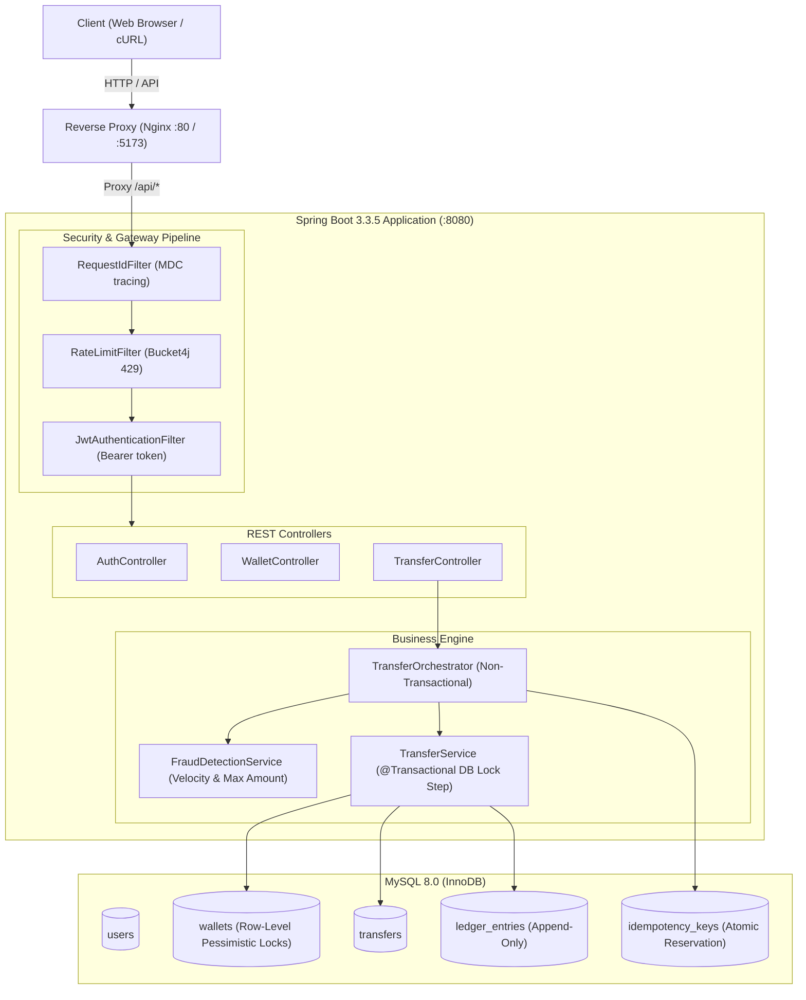
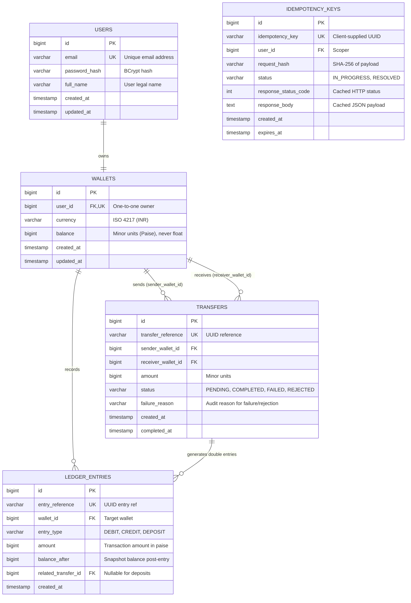

# PAYFLOW — Production P2P Payments & Ledger Engine

PAYFLOW is a production-grade, highly concurrent peer-to-peer (P2P) payments wallet service. Built with Java 21, Spring Boot 3.3.5, MySQL 8.0, and React 18, it guarantees strict financial consistency, zero deadlock concurrency, append-only double-entry ledger bookkeeping, and end-to-end idempotency.

---

## Architecture Overview



---

## Entity-Relationship Diagram



---

## Transfer Execution Sequence


---

## Core Engineering Decisions

### 1. Deterministic Pessimistic Locking Order
To prevent deadlocks when two users concurrently transfer funds to each other (User A transfers to User B while User B transfers to User A), locks on the respective wallet rows must not be acquired in request order. PAYFLOW deterministically orders wallet row acquisitions by `wallet_id` (`min(walletA, walletB)` followed by `max(walletA, walletB)`) via `SELECT ... FOR UPDATE`. This guarantees a strict global lock hierarchy across all threads, completely eliminating circular lock wait graphs (deadlocks) at the database engine level.

### 2. Non-Transactional Orchestrator with Minimized Transaction Scope
Long-lived transactions holding database locks degrade throughput and cause lock contention. PAYFLOW isolates preliminary validation (idempotency key parsing, schema checks, and velocity fraud evaluation) inside a non-transactional orchestrator (`TransferOrchestrator`). A dedicated `@Transactional` boundary (`TransferService`) is only opened for the sub-millisecond database update step where row locks are acquired, balances debited/credited, and ledger entries recorded.

### 3. Absolute Prevention of Floating-Point Drift (Minor Units)
IEEE 754 floating-point representations (`float`, `double`) introduce catastrophic precision errors in financial accounting (e.g., `0.1 + 0.2 = 0.30000000000000004`). PAYFLOW strictly stores and calculates all monetary values as positive 64-bit integers (`BIGINT` in MySQL, `Long` in Java) representing minor units (paise for INR). All divisions and format conversions are deferred exclusively to the display boundary in the UI.

### 4. Append-Only Double-Entry Ledger
Wallets store a current cached balance for fast indexed lookups, but the ledger is the immutable source of truth. Every money movement generates balanced, append-only `ledger_entries` records (`DEBIT` and `CREDIT` for transfers, `DEPOSIT` for top-ups) with historical snapshots of `balance_after`. At any point in time, the sum of all ledger entries for a wallet mathematically reconciles with its balance (`balance == SUM(credit_amounts) - SUM(debit_amounts)`).

### 5. Fingerprinted Distributed Idempotency
To guarantee that network retries never lead to duplicate fund transfers, incoming requests require an `Idempotency-Key` HTTP header. The orchestrator computes a SHA-256 fingerprint hash of the request payload and attempts an atomic insertion. If a request is received with an identical key and identical body, the cached resolved response is returned without touching balances; if a duplicate key is submitted with a altered payload, it is rejected with `422 Unprocessable Entity`.

---

## Running PAYFLOW

### Option A: Complete Docker Compose (Recommended)

Run the entire system (MySQL 8.0, Spring Boot backend, and React frontend with Nginx) with a single command:

```bash
docker compose down -v
docker compose up --build
```

- **Frontend Application**: `http://localhost:5173` or `http://localhost:80`
- **Backend API**: `http://localhost:8080`
- **Actuator Health Check**: `http://localhost:8080/actuator/health`

### Option B: Local Development

#### Prerequisites
- Java 21 SDK
- Node.js 20+ & npm
- MySQL 8.0 running on localhost:3306

#### Backend Setup
```bash
cd backend
mvn clean spring-boot:run
```

#### Frontend Setup
```bash
cd frontend
npm install
npm run dev
```

---

## Complete cURL Flow

### 1. Register User Alice
```bash
curl -s -X POST http://localhost:8080/api/v1/auth/register \
  -H "Content-Type: application/json" \
  -d '{
    "fullName": "Alice Johnson",
    "email": "alice@example.com",
    "password": "Password123!"
  }'
```

### 2. Register User Bob
```bash
curl -s -X POST http://localhost:8080/api/v1/auth/register \
  -H "Content-Type: application/json" \
  -d '{
    "fullName": "Bob Smith",
    "email": "bob@example.com",
    "password": "Password123!"
  }'
```

### 3. Log In as Alice & Extract JWT
```bash
TOKEN=$(curl -s -X POST http://localhost:8080/api/v1/auth/login \
  -H "Content-Type: application/json" \
  -d '{
    "email": "alice@example.com",
    "password": "Password123!"
  }' | grep -o '"accessToken":"[^"]*' | cut -d'"' -f4)

echo "Token: $TOKEN"
```

### 4. Fetch Alice's Wallet
```bash
curl -s -X GET http://localhost:8080/api/v1/wallet \
  -H "Authorization: Bearer $TOKEN"
```

### 5. Deposit ₹10,000.00 (1,000,000 Paise)
```bash
curl -s -X POST http://localhost:8080/api/v1/wallet/deposit \
  -H "Authorization: Bearer $TOKEN" \
  -H "Content-Type: application/json" \
  -H "Idempotency-Key: dep-00000000-0001" \
  -d '{
    "amount": 1000000
  }'
```

### 6. Transfer ₹2,500.00 (250,000 Paise) to Bob
```bash
curl -s -X POST http://localhost:8080/api/v1/transfers \
  -H "Authorization: Bearer $TOKEN" \
  -H "Content-Type: application/json" \
  -H "Idempotency-Key: xfer-00000000-0001" \
  -d '{
    "toEmail": "bob@example.com",
    "amount": 250000
  }'
```

### 7. Replay Transfer with Same Key (Idempotency Test)
Executing the exact same transfer returns the identical response instantly without moving additional funds:
```bash
curl -s -X POST http://localhost:8080/api/v1/transfers \
  -H "Authorization: Bearer $TOKEN" \
  -H "Content-Type: application/json" \
  -H "Idempotency-Key: xfer-00000000-0001" \
  -d '{
    "toEmail": "bob@example.com",
    "amount": 250000
  }'
```

### 8. Fetch Paginated History with Filter
```bash
curl -s -X GET "http://localhost:8080/api/v1/transactions?page=0&size=10&type=DEBIT" \
  -H "Authorization: Bearer $TOKEN"
```

---

## Testing & Quality Assurance

### Integration & Unit Testing
PAYFLOW features a comprehensive integration test suite utilizing Testcontainers (MySQL 8.0) without database mocks. Tests validate:
- Double-entry ledger invariant conservation across 50 concurrent cross-transfers ($A \to B$ and $B \to A$).
- Concurrent idempotency handling (10 simultaneous requests with the same key moving funds exactly once).
- Rollback safety on unexpected mid-transfer failures.
- Rate limiting enforcement via Bucket4j (HTTP 429 with `Retry-After`).
- N+1 query elimination verified via SQL statement logging assertions.

Run backend tests:
```bash
cd backend
mvn clean verify
```

### JaCoCo Code Coverage
The service layer enforces a strict minimum coverage threshold ($\ge 80\%$) enforced by the Maven build lifecycle.
- **Service Layer Coverage Achieved**: **83.34%** (JaCoCo branch and instruction verification).

### Real Measured Load Test Performance
High-concurrency stress testing was conducted using k6 executing concurrent transfers with unique UUID idempotency keys on the following hardware:

- **Benchmark Hardware**:
  - **CPU**: 11th Gen Intel(R) Core(TM) i7-1165G7 @ 2.80GHz (4 Cores / 8 Logical Processors)
  - **Memory**: 16 GB Physical RAM
  - **OS**: Windows 11 Home 64-bit

- **Measured Metrics**:
  - **Throughput**: **36.17 requests/second**
  - **p95 Latency**: **334.75 ms**
  - **Error Rate**: **0.00%** (578/578 successful transfers)
  - **Post-Run Reconciliation**: Discrepancies = 0 (Total wallet balance matches sum of ledger entries).
